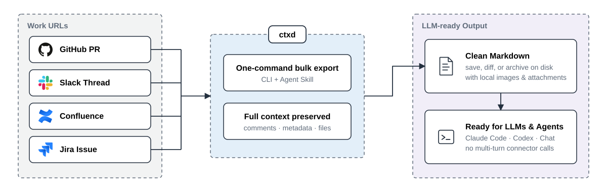

# ctxd

Turn work URLs into LLM-ready Markdown.

**📖 [中文文档](README_CN.md) · [Auth Setup](docs/auth.md) · [CLI Reference](docs/cli.md)**



GitHub PRs, Slack threads, Confluence pages, and Jira issues — one command, one Markdown artifact you can save, diff, or feed to a model.

## Why ctxd

- **CLI-first, not chat-first** — one command produces a stable local artifact instead of drip-feeding context across many in-model connector calls.
- **Comments and metadata stay attached** — PR reviews and inline threads, Slack threading, Confluence attachments and page metadata, Jira custom fields all preserved.
- **Bulk export by default** — whole Confluence page trees, long Slack threads, and heavy PRs export in parallel (see [`bench/results/`](bench/results/) for measured numbers).
- **Never silent on data loss** — fetch failures, skipped items, and truncations always warn on stderr and appear in the completeness summary / `manifest.json`, even under `-q`.

## Installation

### 1. Install `ctxd`

```bash
# Homebrew (recommended)
brew tap cheerchen/tap
brew install ctxd

# Or from source
uv sync --group dev
```

### 2. Add the agent skill (recommended)

The companion skill at [`skills/ctxd/SKILL.md`](skills/ctxd/SKILL.md) teaches **Claude Code** and **Codex CLI** to reach for `ctxd` automatically whenever a supported URL appears:

```bash
mkdir -p ~/.claude/skills && ln -s "$(realpath skills/ctxd)" ~/.claude/skills/ctxd
mkdir -p ~/.codex/skills  && ln -s "$(realpath skills/ctxd)" ~/.codex/skills/ctxd
```

### 3. Configure credentials

Put tokens for the sources you use in `~/.config/ctxd/config` (`chmod 600`) or export them in your environment. See **[Authentication & Configuration](docs/auth.md)** for required scopes and SSO notes.

```bash
GITHUB_TOKEN=ghp_...
SLACK_TOKEN=xoxp-...
CONFLUENCE_BASE_URL=https://your-site.atlassian.net
CONFLUENCE_EMAIL=you@example.com
CONFLUENCE_API_TOKEN=your-token
```

## Quick start

```bash
# GitHub PR -> auto-named markdown file (pass -d full to include code diff)
ctxd -O https://github.com/owner/repo/pull/123

# Slack thread -> stdout (pass --since <ts> later for new replies only)
ctxd https://app.slack.com/client/T.../C.../thread/C...-1234567890.123456

# Confluence page tree with images -> local directory
ctxd https://your-site.atlassian.net/wiki/spaces/SPACE/pages/123456 -r -i -O

# Jira issue with referenced images -> local file
ctxd https://your-site.atlassian.net/browse/PROJECT-123 -i -O
```

| Source | Supported URL Pattern |
|--------|-----------------------|
| GitHub PR | `https://github.com/<owner>/<repo>/pull/<number>` |
| Slack Thread | `https://*.slack.com/archives/...` or `.../client/.../thread/...` |
| Confluence | `https://*.atlassian.net/wiki/...` (including `/wiki/x/<token>` tiny links) |
| Jira | `https://*.atlassian.net/browse/<KEY>`, `https://*.atlassian.net/servicedesk/customer/portal/<id>/<KEY>` |

## Documentation

| Guide | Contents |
|-------|----------|
| [Authentication & Configuration](docs/auth.md) | Token types, required scopes, SAML SSO, config file precedence |
| [CLI Reference](docs/cli.md) | Global flags, per-source options, Slack `--since`, Confluence layouts, cross-source recursion, `manifest.json` & size caps |
| [Agent Skill](skills/ctxd/SKILL.md) | Prompt instructions and default flag conventions for AI coding agents |
| [Benchmarks](bench/results/) | Reproducible wall-time, request-count, and memory measurements (`uv run scripts/bench.py`) |

## License

[MIT](LICENSE)
