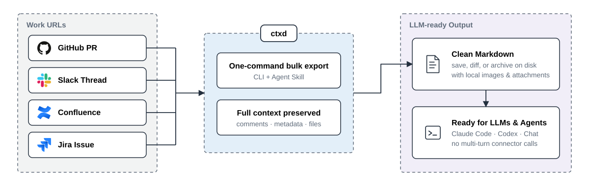

# ctxd

把工作 URL 变成适合喂给 LLM 的 Markdown。

**📖 [English](README.md) · [认证与配置](docs/auth_cn.md) · [CLI 参考手册](docs/cli_cn.md)**



GitHub PR、Slack thread、Confluence 页面、Jira issue —— 一条命令导出成干净、可落盘、可复查的 Markdown。

## 为什么用 ctxd

- **CLI 优先，不是聊天优先**：一条命令生成稳定本地文件，省去模型内 connector 反复多轮调用的开销，便于检查、diff 与复用。
- **评论和元数据完整保留**：PR review 与行内评论、Slack 线程上下文、Confluence 页面元数据与附件清单、Jira 自定义字段一并保留。
- **默认面向批量导出**：整棵 Confluence 页面树、长 Slack thread、大体积 PR 均支持并发拉取（实测数据见 [`bench/results/`](bench/results/)）。
- **数据丢失绝不静默**：抓取失败、跳过项与截断始终输出到 stderr 并记录在运行摘要 / `manifest.json` 中，即使开启 `-q` 也不会隐藏。

## 安装与配置

### 1. 安装 `ctxd`

```bash
# Homebrew（推荐）
brew tap cheerchen/tap
brew install ctxd

# 或从源码安装
uv sync --group dev
```

### 2. 安装 Agent Skill（推荐）

配套 skill（[`skills/ctxd/SKILL.md`](skills/ctxd/SKILL.md)）可同时用于 **Claude Code** 和 **Codex CLI**，让 agent 遇到受支持的 URL 时自动调用 `ctxd`：

```bash
mkdir -p ~/.claude/skills && ln -s "$(realpath skills/ctxd)" ~/.claude/skills/ctxd
mkdir -p ~/.codex/skills  && ln -s "$(realpath skills/ctxd)" ~/.codex/skills/ctxd
```

### 3. 配置凭证

在 `~/.config/ctxd/config`（建议 `chmod 600`）或环境变量中配置所需数据源的凭证。各平台 Token 获取方式、权限范围与 SAML 授权说明见 **[认证与配置](docs/auth_cn.md)**。

```bash
GITHUB_TOKEN=ghp_...
SLACK_TOKEN=xoxp-...
CONFLUENCE_BASE_URL=https://your-site.atlassian.net
CONFLUENCE_EMAIL=you@example.com
CONFLUENCE_API_TOKEN=your-token
```

## 快速上手

```bash
# GitHub PR -> 自动命名 Markdown 文件（审查代码改动请加 -d full）
ctxd -O https://github.com/owner/repo/pull/123

# Slack thread -> 输出到 stdout（后续可用 --since <ts> 只拉新增回复）
ctxd https://app.slack.com/client/T.../C.../thread/C...-1234567890.123456

# Confluence 页面树 + 图片 -> 导出到本地目录
ctxd https://your-site.atlassian.net/wiki/spaces/SPACE/pages/123456 -r -i -O

# Jira issue + 正文引用的图片 -> 本地文件
ctxd https://your-site.atlassian.net/browse/PROJECT-123 -i -O
```

| 数据源 | 支持的 URL 模式 |
|--------|-----------------|
| GitHub PR | `https://github.com/<owner>/<repo>/pull/<number>` |
| Slack Thread | `https://*.slack.com/archives/...` 或 `.../client/.../thread/...` |
| Confluence | `https://*.atlassian.net/wiki/...`（含 `/wiki/x/<token>` 短链接） |
| Jira | `https://*.atlassian.net/browse/<KEY>`、`https://*.atlassian.net/servicedesk/customer/portal/<id>/<KEY>` |

## 文档导航

| 文档 | 内容 |
|------|------|
| [认证与配置](docs/auth_cn.md) | 各平台 Token 类型、权限 Scope、SAML SSO 授权、环境变量优先级 |
| [CLI 参考手册](docs/cli_cn.md) | 通用参数、各数据源专属参数、Slack `--since` 增量跟进、Confluence / Jira `--only comments` 只取评论、Confluence 目录规则、跨源递归、`manifest.json` 与体积上限 |
| [Agent Skill](skills/ctxd/SKILL.md) | 面向 AI 编程助手的调用约定与默认参数说明 |
| [性能基准](bench/results/) | 各场景耗时、请求数与峰值内存实测记录（`uv run scripts/bench.py`） |

## 许可证

[MIT](LICENSE)
